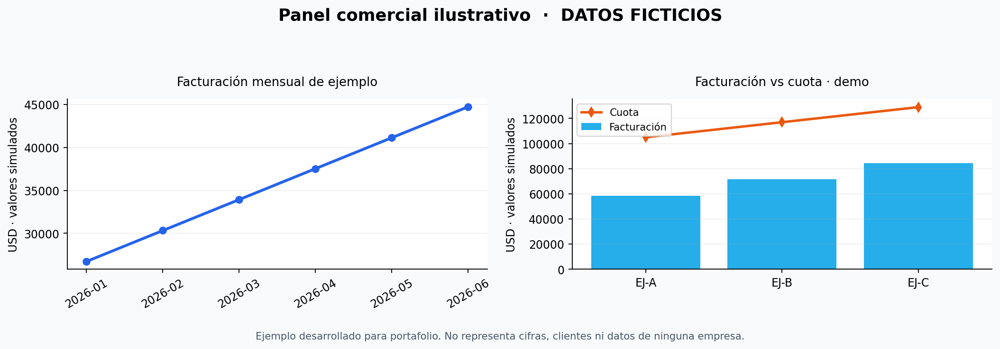

# Arquitectura de Datos y Business Intelligence | Proyecto Académico UPC

**Curso:** Fundamentos de Base de Datos — Especialización Data Science for Business (UPC, 2026)  
**Caso de estudio:** Gestión comercial de una empresa de soluciones energéticas (caso anonimizado)  
**Tecnologías del trabajo académico:** Oracle Database, MongoDB, Excel, Power BI  
**Complemento público reproducible:** Python, pandas y datos sintéticos

> **IMPORTANTE:** Esta es una **adaptación pública de portafolio** basada en un trabajo académico grupal. Los datos, consultas SQL complementarias, scripts Python y gráficos demostrativos del repositorio se han preparado con **información totalmente ficticia**. **No** son un volcado de una base de datos real ni una copia de la implementación interna de una empresa. La arquitectura Oracle–MongoDB es una **propuesta académica**; no se presenta como un despliegue de producción.



## 1. Problema y objetivo

El caso aborda cómo obtener una visión integrada de la facturación histórica, las cuotas de ventas y las oportunidades comerciales para apoyar decisiones de gerencia. El trabajo de la UPC incluyó la justificación de una arquitectura de bases de datos y un dashboard de Power BI.

## 2. Diseño propuesto en el trabajo original

| Fuente | Tipo de información | Uso analítico |
|---|---|---|
| Oracle Database (relacional) | Histórico de facturación | Ingresos y tendencias comerciales |
| MongoDB (documental) | Metas y avance de asesores | Comparación de cumplimiento |
| Excel | Oportunidades comerciales | Seguimiento de pipeline |
| Power BI | Consumo de los tres orígenes | Indicadores y reportes |

El trabajo evaluó bases de datos relacionales y NoSQL, alternativas de licenciamiento, nube administrada (PaaS) y la necesidad de administración de datos. La propuesta contempló Oracle Autonomous Database (OCI) y MongoDB Atlas. **Esta publicación no afirma que la arquitectura se encuentre desplegada en producción.**

Consulta el detalle conceptual en [`docs/arquitectura.md`](docs/arquitectura.md).

## 3. Demostración pública reproducible

Se incluye una **demostración nueva** creada para presentar de forma segura las ideas del caso:

- Tres archivos CSV con información sintética: facturación, cuotas y oportunidades.
- Un ejemplo JSON de cuotas, ilustrando su representación documental.
- Consultas SQL Oracle *ilustrativas* y un esquema de ejemplo.
- Un script Python/pandas que valida columnas, unicidad y valores no negativos, consolida indicadores y exporta resúmenes.
- Un dashboard estático de muestra, basado únicamente en números inventados.

**No se incluye** el Power BI `.pbix` original, exportaciones comerciales, documentos internos, credenciales ni enlaces a reportes privados.

## 4. Estructura

```text
.
├── README.md
├── requirements.txt
├── .gitignore
├── assets/
│   └── dashboard_demo_sintetico.png
├── datos_sinteticos/
│   ├── facturacion.csv
│   ├── cuotas.csv
│   ├── cuotas_ejemplo_mongodb.json
│   └── oportunidades.csv
├── docs/
│   ├── arquitectura.md
│   ├── diccionario_datos.md
│   └── publicacion_segura.md
└── scripts/
    ├── analizar_demo.py
    └── consultas_oracle_ejemplo.sql
```

## 5. Ejecutar la demostración

Requisitos: Python 3.10+ y pandas.

```bash
python -m pip install -r requirements.txt
python scripts/analizar_demo.py
```

El programa crea una carpeta `resultados_demo/` con tablas de resumen. Los resultados son **únicamente demostrativos**.

## 6. Competencias demostradas y límites

**Proyecto académico original:** evaluación de una solución de datos híbrida, selección de motores, análisis de requisitos y desarrollo de un reporte Power BI a partir de fuentes diferentes.  
**Extensión de portafolio:** esquema de datos de ejemplo, documentación, reglas de calidad, SQL demostrativo y análisis con pandas.

No se declara experiencia con procedimientos de producción, administración efectiva de Oracle/MongoDB a escala ni implementación real de procesos ETL programados por el solo hecho de presentar este caso.

## 7. Autoría y privacidad

Trabajo académico desarrollado en equipo dentro del curso de la UPC. Este repositorio es una adaptación pública para exhibir habilidades personales; no implica respaldo, patrocinio ni autorización de la empresa cuyo caso inspiró el análisis. No incluye datos corporativos ni reproduce los nombres de compañeros sin consentimiento.

**Nota:** Para compartir materiales originales de un trabajo grupal o una empresa, primero se deben obtener los permisos correspondientes.
