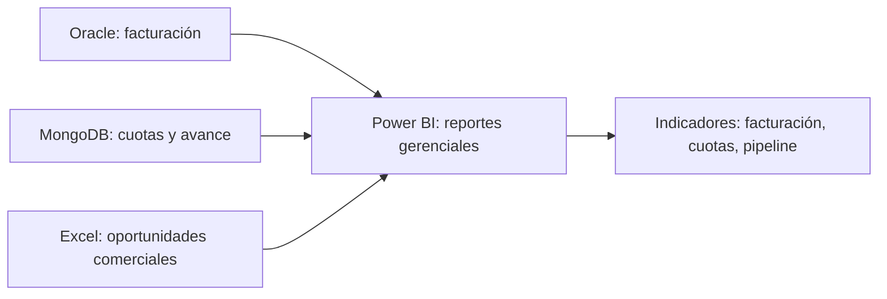

# Arquitectura conceptual del caso

**Distinción:** la solución Oracle + MongoDB + Excel se planteó y justificó en el trabajo académico. Este archivo es un resumen de esa propuesta; no es documentación de un sistema empresarial implementado.

## Criterios de selección

- **Oracle (relacional):** facturas y datos estructurados, integridad y control transaccional.
- **MongoDB (documental):** estructura flexible para información de cuotas y seguimiento.
- **Excel:** entrada complementaria para oportunidades de negocio en el ejercicio académico.
- **Power BI:** vistas que apoyan a gerencia comercial y dirección.
- **Cloud/PaaS:** opción propuesta para externalizar tareas de infraestructura; en el informe académico se consideraron OCI y MongoDB Atlas.

## Aclaración sobre el ejercicio público

Los ficheros de `datos_sinteticos/` son independientes de los utilizados por la empresa; sus nombres y cifras se generaron únicamente para ilustración. `scripts/analizar_demo.py` procesa esos CSV localmente; no se conecta a Oracle, MongoDB ni a los reportes internos. El ejemplo de SQL tampoco se extrajo de los sistemas empresariales.
